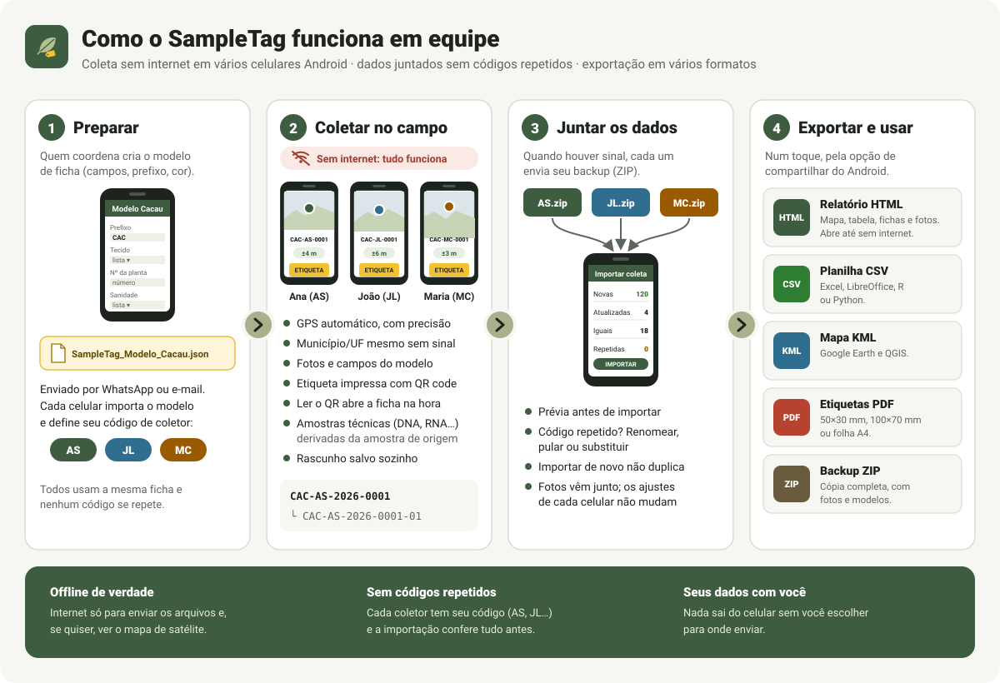

  

<h1 align="center">SampleTag</h1>

<b>Registro e etiquetagem de amostras de campo, direto no celular Android — mesmo sem internet.</b>

O SampleTag é um **aplicativo para Android** feito para quem coleta amostras no campo (folhas, frutos, solo, tecidos…) e precisa anotar tudo com cuidado: onde, quando, por quem e em que condições. Cada amostra ganha um código único, coordenadas de GPS, fotos e uma etiqueta impressa com QR code. Depois, os dados de toda a equipe são juntados num só aparelho e viram um relatório com mapa, uma planilha ou um arquivo para o Google Earth.

O app **funciona sem internet**: tudo fica salvo no próprio celular.

  

## Instalação

O SampleTag funciona em celulares e tablets com **Android 7.0 ou mais recente**. Não está na Play Store: a instalação é feita com o arquivo do app (APK).

1. Abra a página de [versões (Releases)](https://github.com/gabrielvpina/sampletag/releases) no celular.
2. Baixe o arquivo **`app-arm64-v8a-release.apk`**, que serve para a grande maioria dos celulares. Em aparelhos muito antigos, use o `app-armeabi-v7a-release.apk`.
3. Abra o arquivo baixado. Se o Android pedir, permita "instalar apps desta fonte" para o navegador ou gerenciador de arquivos.
4. Para atualizar, baixe e instale a versão nova por cima. As amostras salvas são mantidas.

## O que o app faz

### Registrar amostras

- **Ficha completa:** data e hora, coletor, contato, clone/genótipo, origem/propriedade, município/UF, observações e instrução de armazenamento.
- **Código automático e único**, como `CAC-AS-2026-0001`: o prefixo do modelo, o código de quem coletou, o ano e a sequência. Dá para editar se preferir.
- **Localização automática:** ao abrir uma amostra nova, o GPS começa a trabalhar sozinho e vai melhorando a precisão até cerca de 20 metros. O app mostra a precisão obtida e avisa quando o sinal está fraco. Também é possível digitar as coordenadas.
- **Município e estado preenchidos pelo GPS**, mesmo sem internet (o app traz os limites oficiais do IBGE).
- **Fotos** da câmera ou da galeria, várias por amostra.
- **Rascunho salvo sozinho:** se o celular desligar ou o app fechar no meio do preenchimento, nada se perde.

### Amostras técnicas

A partir de uma amostra biológica (por exemplo, uma folha), crie **amostras técnicas derivadas**, como DNA ou RNA extraídos dela. Elas recebem o código da amostra de origem com um número (`CAC-AS-2026-0001-01`, `-02`…), já vêm com o local, o coletor e os campos preenchidos, e cada ficha mostra a ligação entre elas.

### Modelos de ficha

Cada tipo de amostra tem um **modelo** com nome, prefixo do código, cor, categoria, instrução de armazenamento e **campos extras** (texto, número, lista de opções ou data, obrigatórios ou não). O app já vem com o modelo **Cacau**.

Para que a equipe toda use a mesma ficha, **compartilhe o modelo**: o app gera um arquivo pequeno que pode ser enviado por WhatsApp ou e-mail e importado nos outros celulares.

### Etiquetas e QR code

- Etiquetas em PDF no formato da ficha, com QR code, nos tamanhos **50×30 mm**, **100×70 mm** ou **folha A4** (8 por página). Imprima ou compartilhe.
- A aba **Escanear** lê o QR da etiqueta e abre a ficha da amostra na hora.

### Lista e mapa

- Busca por código, clone, coletor ou qualquer campo, mesmo sem acentos, além de filtros por modelo, período, coletor e município.
- **Seleção de várias amostras:** um toque longo ativa a seleção, para imprimir as etiquetas ou excluir várias de uma vez.
- **Mapa** com todas as amostras, com limites de estados e municípios que funcionam offline.

## Trabalhar em equipe

Várias pessoas podem coletar ao mesmo tempo, cada uma no seu celular e sem internet. Os dados são juntados depois.

1. **Cada celular tem um código de coletor** (por exemplo, as iniciais: AS, JL, MC). O app pede esse código na primeira amostra. Com ele, duas pessoas nunca geram o mesmo código de amostra.
2. **No fim da coleta**, cada pessoa vai em *Exportar → Criar backup (ZIP)* e envia o arquivo para quem vai juntar os dados.
3. **Quem junta** usa *Exportar → Importar coleta de outro celular* para cada arquivo recebido. Antes de importar, o app mostra uma prévia com as amostras novas, as atualizadas e as que já existem. Se aparecer um código repetido, você escolhe entre renomear, pular ou substituir.
4. Pode importar o mesmo arquivo de novo (por exemplo, uma versão mais atualizada) sem duplicar nada. As fotos vêm junto e as configurações de quem importa não mudam.

## Exportar os resultados

Na aba **Exportar**, escolha todas as amostras ou só as filtradas na lista e envie o arquivo pela opção de compartilhar do Android.

| Formato | Para quê |
|---|---|
| **Relatório HTML** | Um único arquivo que abre em qualquer navegador, mesmo sem internet: mapa das amostras, resumo por modelo, coletor e município, tabela com busca e ordenação, uma ficha por amostra com fotos e QR code. Tem botões para baixar a planilha e imprimir. |
| **Planilha CSV** | Para Excel, LibreOffice, R ou Python, com todas as colunas e os campos extras. |
| **KML** | Para ver os pontos no Google Earth ou no QGIS. |
| **Etiquetas PDF** | Para imprimir as etiquetas de várias amostras de uma vez. |
| **Backup ZIP** | Cópia completa (amostras, modelos e fotos), para guardar ou para enviar a coleta a outra pessoa. |

### O mapa do relatório

- **Com internet**, o mapa mostra imagens de **satélite** (ou ruas, se preferir) e aproxima até poucos metros, para separar plantas vizinhas.
- **Sem internet**, o mapa usa os limites de estados e municípios do IBGE que vêm dentro do arquivo.
- O **mapa estático** também aproxima (roda do mouse, gesto de pinça ou botões +/−) e é o que sai na impressão, do jeito que estiver na tela.

Veja um exemplo: [relatório de demonstração](demo/) com amostras fictícias de fazendas de cacau no sul da Bahia.

## Privacidade

- Todos os dados ficam **somente no seu celular**. Nada é enviado a lugar nenhum sem você escolher o destino.
- A **câmera** (fotos e leitura de QR) e a **localização** são pedidas só na hora do uso, com explicação.
- A **internet** é opcional: serve para mostrar o fundo do mapa e, como reserva, para identificar o município fora do Brasil.

---

Para quem desenvolve: veja a [documentação interna](docs/).
